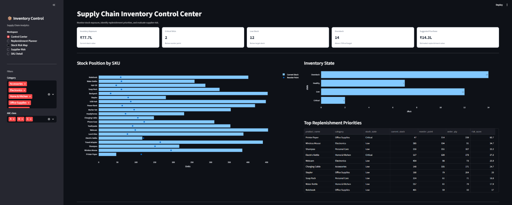

# Tauheed Nafees | Portfolio

B.Tech Computer Science (AI & ML) student aspiring to become a Data Analyst. This portfolio showcases my projects, technical skills, certifications, and professional profile.

## 📊 Featured Projects

### 1. Customer Segmentation — RFM Analysis
Customer segmentation using Recency, Frequency, and Monetary analysis to identify customer groups and support data-driven business decisions.

**Tools:** Python, Pandas, Streamlit, Data Visualization


### 2. Supply Chain Inventory Optimization
An interactive application for analyzing inventory, monitoring stock levels, evaluating suppliers, and supporting inventory management decisions.

**Tools:** Python, Pandas, Streamlit, Data Visualization



## 🛠️ Skills & Tools


## 📁 Project Structure

```text
Tauheed_Nafees_Portfolio/
├── index.html
├── styles.css
├── script.js
└── assets/
    ├── icons/
    │   ├── excel.svg
    │   ├── git.svg
    │   ├── jupyter.svg
    │   ├── lnkedin.svg
    │   ├── mysql.svg
    │   ├── phone.svg
    │   ├── powerbi.svg
    │   ├── python.svg
    │   ├── sql.svg
    │   ├── tableau.svg
    │   └── whatsaoo.svg
    └── images/
        ├── profile.jpg
        ├── rfm1.jpg
        ├── rfm2.jpg
        ├── rfm3.jpg
        ├── rfm4.jpg
        ├── supply1.png
        ├── supply2.png
        ├── supply3.png
        ├── supply4.png
        ├── supply5.png
        └── certificates/
            ├── Course Tauheed Nafees.pdf
            ├── databricks_certificate.pdf
            ├── python_certificate_adv.png
            ├── simplilearn_data_analytics.png
            └── The_Ultimate_Job_Ready_Data_Science_Course_Certificate.pdf
```

## 🎓 Certifications

- Introduction to Data Analytics — Simplilearn
- Databricks Certificate
- Advanced Python Certificate
- The Ultimate Job Ready Data Science Course
- Additional Course Certificate

## 📬 Connect With Me

- **GitHub:** [tauheednafees1-cpu](https://github.com/tauheednafees1-cpu)
- **LinkedIn:** [Tauheed Nafees](https://www.linkedin.com/in/tauheed-nafees-ab6b222a9/)
- **Email:** [tauheednafees1@gmail.com](mailto:tauheednafees1@gmail.com)

---

*Built to showcase my learning journey and projects in Data Analytics.*